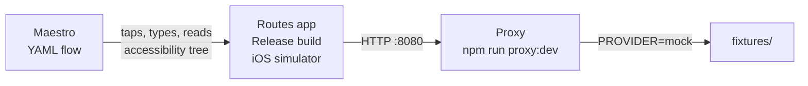

# Routes — Integration tests with Maestro

Related: [Test plan §8](test-plan.md#8-end-to-end-tests--maestro-e2e-) · [Developer guide](developer.md) · [Architecture](architecture.md) · [Fixtures](../fixtures/README.md) · workflow [`.github/workflows/e2e.yml`](../.github/workflows/e2e.yml)

How the Maestro integration suite is built, run and extended. The test plan calls these tests **E2E** (test IDs `E2E-01` to `E2E-17`); this document uses "integration tests" and "E2E" interchangeably.

## 1. What these tests prove

Each flow drives the **real, compiled iOS app** in a simulator the way a person would: tapping, typing and reading the screen. The app talks to the **real proxy** over HTTP, so the whole stack is tested together:



| Part | Real or stand-in |
|---|---|
| App binary | **Real**: Release configuration, the same JavaScript bundle and native modules that ship |
| Navigation, state, SQLite storage, ranking (`routing-core`) | **Real** |
| Proxy: validation, rate limiting, caching, normalization | **Real** |
| Google Routes and Places APIs | **Stand-in**: the proxy's mock provider serves [fixtures](../fixtures/README.md) |
| Map tiles | Apple Maps (`EXPO_PUBLIC_MAP_PROVIDER=default`), so no Google key is needed |
| Location | Simulator location fixed at the fixture origin, **Denver 39.7392, -104.9903** |
| Location permission | Preset per flow: granted (`inuse`) or denied (`never`) |
| Google Maps app | Not installed on the simulator, which is exactly what E2E-13 tests |
| App Attest | Off (`ATTEST_MODE=off`) |

The Jest suites test pieces in isolation, with mocks for native modules and the network. These flows are the only automated check that the pieces work together in a real build.

**Not covered** (manual tests in [test plan §9](test-plan.md#9-manual-tests-man--human-real-iphone-before-beta)): live Google data, handing off to an installed Google Maps app, VoiceOver and Dynamic Type on a device, and App Attest.

## 2. Layout

```
apps/mobile/e2e/
├─ common/                 Reusable steps, called with runFlow
│  ├─ launch-granted.yaml    Set location to Denver, fresh install, location allowed
│  ├─ home.yaml              launch-granted → onboarding → Allow → Home ("From: Current location")
│  ├─ search-to.yaml         From Home: open Search for To, type ${QUERY}, pick suggestion ${PLACE_ID}
│  ├─ results-union.yaml     home → search "Union" → Union Station → 3 route cards
│  └─ detail-a.yaml          results-union → "Go with route A" → detail (cost card visible)
├─ flows/                  One file per test ID: E2E-01 to E2E-15 and E2E-17
│  └─ e2e-NN-<slug>.yaml
└─ offline/                E2E-16, split around stopping the proxy
   ├─ e2e-16a-prepare.yaml   Proxy up: leave Union Station in recents
   └─ e2e-16b-offline.yaml   Proxy down: recents listed; route request shows "You're offline"
```

Every file starts with `appId: com.routes.app.dev` (the development bundle ID), then `---`, then the steps.

## 3. Anatomy of a flow

```yaml
# E2E-04: search "Union" → Union Station → 3 cards; card A 22 min, $5.12 (test plan §2).
appId: com.routes.app.dev
---
- runFlow: ../common/results-union.yaml      # setup shared with other flows
- assertVisible: '3 routes'                  # match by visible text
- assertVisible:
    id: 'route-card-A'                       # match by testID…
    text: "Route A, fastest, 22 minutes, 9.8 miles, via Hwy 12, estimated cost \\$5\\.12 including \\$3\\.75 toll"
                                             # …and its accessibility label (a regex)
```

### Maestro commands used

| Command | Used for |
|---|---|
| `setLocation` | Put the simulator at the fixture origin before launch |
| `launchApp` with `clearState: true` and `permissions` | Fresh install with location `inuse` (granted) or `never` (denied). iOS values are `always`, `inuse`, `never` and `unset`, not `allow`/`deny`. |
| `launchApp` / `stopApp` without `clearState` | Relaunch keeping data, to check persistence (E2E-05, E2E-16) |
| `runFlow` (with `env`) | Reuse `common/` steps; `search-to.yaml` takes `QUERY` and `PLACE_ID` |
| `tapOn`, `inputText`, `eraseText` | Interaction |
| `extendedWaitUntil: { visible, timeout }` | Wait for the next screen or result. Use it instead of fixed sleeps. |
| `assertVisible` / `assertNotVisible` | Checks, including `selected: true` for the mode toggle |
| `scrollUntilVisible` | Reach the Save button below the keyboard on Edit vehicle |

### How elements are found

Maestro reads the iOS **accessibility tree**, so it matches what VoiceOver would announce.

- **testIDs** for elements whose text changes or repeats:

  | testID | Element |
  |---|---|
  | `field-from`, `field-to` | Trip fields on Home |
  | `swap` | Swap button |
  | `mode-fastest`, `mode-cheapest` | Mode toggle segments |
  | `search-input` | Search field |
  | `suggestion-<placeId>` | A search result, e.g. `suggestion-fixture-union-station` |
  | `route-card-A`, `route-card-B`, `route-card-C` | Route cards |
  | `results-map` | Results map |
  | `cost-card` | Cost breakdown on Route detail |
  | `vehicle-mpg`, `vehicle-price`, `vehicle-save` | Edit vehicle fields and Save |

- **Visible text or accessibility label** for copy checks: `'Only 2 routes found'`, `"Couldn't load routes"`.
- **Text is a regular expression.** Escape `$`, `.`, `(` and `)`, so `"\\$5\\.12"` matches "$5.12". Use `.*` for a prefix match, e.g. `'From: Current location.*'`, since the label continues with the street address.
- **Grouped elements.** A route card is a single VoiceOver element, so text inside it, such as "Best of 3" or the difference line, isn't separately matchable. Assert on the card's full accessibility label instead.

## 4. Flow catalogue

All expected values come from [test plan §2](test-plan.md#2-canonical-fixture-and-expected-values).

| ID | File | Setup | Verifies | Req |
|---|---|---|---|---|
| E2E-01 | `e2e-01-onboarding-allow` | Fresh, granted | Onboarding title and footnote → Allow → Home shows "From: Current location" and the mode toggle | FR-1, FR-2 |
| E2E-02 | `e2e-02-enter-start` | Fresh | "Enter a start address instead" → search "Union" → Union Street Market becomes the start | US-2 |
| E2E-03 | `e2e-03-denied` | Fresh, **denied** | Allow → "From: Enter a start address" and "Turn on in Settings" | FR-3 |
| E2E-04 | `e2e-04-search-results` | results-union | "3 routes"; card A's label: fastest, 22 min, 9.8 mi, via Hwy 12, $5.12 including $3.75 toll; cards B and C present | FR-5, FR-8, FR-13 |
| E2E-05 | `e2e-05-cheapest-persists` | results-union | Cheapest → "Ranked by trip cost", card A is "cheapest, 31 minutes"; after relaunch the Cheapest segment is still selected | FR-10, FR-11 |
| E2E-06 | `e2e-06-detail-b` | results-union | Select card B → "Go with route B" → "via Elm Ave & 3rd St · Union Station", "No tolls", "$1.48", "Trip cost (estimated)" | FR-14, FR-15 |
| E2E-07 | `e2e-07-edit-vehicle` | detail-a | "Set your vehicle" → 40 mpg, $4.00 → Save → "$4.73" and "Fuel uses your vehicle settings." | FR-19 |
| E2E-08 | `e2e-08-recent-one-tap` | results-union | Back to Home → "Union Station, 100 Union Plaza" in recents → one tap → Results | US-4, FR-6 |
| E2E-09 | `e2e-09-clear-recents` | results-union | Clear → confirm → recent and the "RECENT" header gone | FR-6 |
| E2E-10 | `e2e-10-two-routes` | home | "Two Routes Test" → "Only 2 routes found"; card B present, card C absent | BR-5 |
| E2E-11 | `e2e-11-error` | home | "Error Test" → "Couldn't load routes", Retry, map still shown | NFR-8 |
| E2E-12 | `e2e-12-no-route` | home | "No Route Test" → "No driving route found", "Change destination" | — |
| E2E-13 | `e2e-13-not-installed` | detail-a | Open in Google Maps → "Google Maps isn't installed" sheet with Open in browser and Get Google Maps → Cancel closes it | FR-17 |
| E2E-14 | `e2e-14-set-home` | home | Set Home → pick Union Station → row reads "Home, 100 Union Plaza" | FR-7 |
| E2E-15 | `e2e-15-swap` | results-union | Back to Home → swap → From is Union Station, To is Current location | FR-4 |
| E2E-16 | `offline/e2e-16a` + `e2e-16b` | results-union, then proxy stopped | Recents still listed; tapping one shows "You're offline" with Retry; back to Home keeps the recent | FR-21 |
| E2E-17 | `e2e-17-performance` | home | From tapping the Union Station suggestion, card C must appear within **3 s** | NFR-1 |

## 5. Running locally

**Needs:** macOS; **Xcode 26 or newer** (Expo SDK 57 needs Swift tools 6.2); an iOS simulator; CocoaPods; Node 22; Maestro and Java 17+ (`curl -fsSL "https://get.maestro.mobile.dev" | bash`, `brew install openjdk@17`).

1. **Start the mock proxy** (terminal 1), with rate limits raised for repeated runs:

   ```
   RATE_LIMIT_ROUTES_PER_HOUR=10000 RATE_LIMIT_PLACES_PER_HOUR=10000 npm run proxy:dev
   curl localhost:8080/healthz          # → {"ok":true}
   ```

2. **Build a Release app for the simulator** (terminal 2). Release bundles the JavaScript into the app, so Metro isn't involved:

   ```
   cd apps/mobile
   npx expo prebuild --platform ios --no-install
   cd ios && pod install
   xcodebuild -workspace Routes.xcworkspace -scheme Routes -configuration Release \
     -sdk iphonesimulator -destination 'generic/platform=iOS Simulator' \
     -derivedDataPath build CODE_SIGNING_ALLOWED=NO build
   ```

   `EXPO_PUBLIC_MAP_PROVIDER` and `EXPO_PUBLIC_PROXY_URL` default to `default` and `http://localhost:8080`, which is what the flows expect.

3. **Boot a simulator and install the app:**

   ```
   xcrun simctl boot "iPhone 16"        # any available iPhone
   open -a Simulator
   xcrun simctl location booted set 39.7392,-104.9903   # warm the location fix
   xcrun simctl install booted build/Build/Products/Release-iphonesimulator/Routes.app
   ```

4. **Run the suite** from the repo root:

   ```
   npm run e2e                                                   # all of flows/
   maestro test apps/mobile/e2e/flows/e2e-07-edit-vehicle.yaml   # one flow
   ```

5. **Run E2E-16 (offline)**, which needs the proxy stopped in the middle:

   ```
   maestro test apps/mobile/e2e/offline/e2e-16a-prepare.yaml
   # stop the proxy (Ctrl+C in terminal 1), then:
   maestro test apps/mobile/e2e/offline/e2e-16b-offline.yaml
   ```

Flows set the location and reset app data themselves, so they can run in any order. Each flow's screenshots and logs are written to `~/.maestro/tests/<timestamp>/`.

**Faster loop while writing a flow:** a debug build (`npm run ios -w @routes/mobile`) also works, since it uses the same bundle ID. `maestro studio` opens a browser view of the live accessibility tree, where you can try selectors and commands interactively.

## 6. In CI

Workflow: [`.github/workflows/e2e.yml`](../.github/workflows/e2e.yml), job **"Maestro E2E (iOS simulator)"**.

**When it runs:**

1. **Path filter.** The workflow starts on PRs touching `apps/mobile/**`, `apps/proxy/**`, `packages/**`, `fixtures/**`, `package.json` or `package-lock.json`, and on every push to `main`.
2. **Change gate.** A quick Linux job, "Decide whether E2E is needed", looks at what *this push* changed:
   - a PR's first run is compared with its base;
   - later pushes are compared only with the previous push;
   - pushes to `main` are compared with the commit before.

   If none of the changed files are code (the app, proxy, packages, fixtures or dependency files, excluding `.md`), the macOS job is skipped with an "E2E skipped" notice. So a docs-only push doesn't rebuild the app, even on a PR that also has code changes. If there's no usable base commit, E2E runs.

A newer push to the same branch cancels a running job. Changes to `e2e.yml` itself don't trigger a run.

**Steps** (runner `macos-26`, overall timeout 120 min):

| # | Step | Detail |
|---|---|---|
| 1 | Select Xcode | `latest-stable` (Xcode 26.x) |
| 2 | `npm ci`, install Maestro | Maestro analytics off; driver startup timeout 180 s |
| 3 | Start the mock proxy | `npm run proxy:dev` in the background, logging to `proxy.log`; waits up to 2 min for `/healthz`. Rate limits are set to 10,000 per hour. |
| 4 | Prebuild and `pod install` | CocoaPods cached by lockfile and `app.config.ts` |
| 5 | Build | `xcodebuild` Release for the simulator, unsigned; derived data cached. On failure it prints the real compiler errors from `xcodebuild.log`. |
| 6 | Boot and install | Picks the newest available iPhone simulator. Each boot attempt is limited to 4 min, with up to 3 attempts, erasing the device between tries, because hosted runners sometimes hang in `bootstatus`. Then it sets the simulator location to Denver (`xcrun simctl location … set`) **before** installing, so a cold simulator already has a location fix; otherwise the first fix can take longer than the app's 5 s location timeout and the app falls back to "location unavailable". Step limit 20 min. |
| 7 | Run flows | `maestro test apps/mobile/e2e/flows --format junit --output e2e-report.xml` (limit 75 min) |
| 8 | Run E2E-16 | Run `16a` → `pkill` the proxy → check `/healthz` is down (the step fails if it isn't) → run `16b` |
| 9 | On failure | Upload artifact **`maestro-e2e`**: `~/.maestro/tests` (per-flow screenshots, command logs), `e2e-report.xml`, `proxy.log` and `xcodebuild.log` |

A full green run takes about **7–8 minutes** of flow time, plus build time (less when caches hit). macOS runner minutes are billed at a higher rate than Linux.

### Reading a failure

1. Open the failed run and download the **`maestro-e2e`** artifact.
2. `e2e-report.xml` names the failing flow and step.
3. In `~/.maestro/tests/<run>/`, open the failing flow's screenshot to see what was on screen when the step failed. The command log shows the selector that didn't match.
4. `proxy.log` shows whether the request reached the proxy and what it returned (no coordinates are logged).
5. Build failures: check `xcodebuild.log`; the step already printed its `error:` lines.

## 7. Writing or changing a flow

1. **Start from the test plan.** Every flow maps to an `E2E-NN` row in [test plan §8](test-plan.md#8-end-to-end-tests--maestro-e2e-). For a new scenario, add the row first.
2. **Name and header.** Use `flows/e2e-NN-<slug>.yaml`, with a first-line comment `# E2E-NN: <what it checks>`.
3. **Reuse `common/`** for setup. Add a new common step only when two or more flows need it.
4. **Prefer testIDs** for anything whose text varies. Add a `testID` in the component if needed; it's invisible to users. Keep copy assertions for copy that matters to the spec.
5. **Use exact values from [test plan §2](test-plan.md#2-canonical-fixture-and-expected-values),** not values read off the screen. Escape regex characters.
6. **Wait, don't sleep.** Use `extendedWaitUntil` with a timeout after every navigation or request. Hosted simulators are slow and uneven, so every wait is at least **60 s**, and the first location fix in `common/home.yaml` gets **90 s**. A generous timeout only costs time when something is actually slow, because Maestro continues as soon as the element appears. Only E2E-17 uses a tight timeout (3 s) on purpose, since that's the speed requirement it checks.
7. **Start clean.** Begin with `launch-granted.yaml` (or `setLocation` plus `launchApp: { clearState: true }`), so flows don't depend on each other.
8. **New fixture data?** Add it in `scripts/fixtures/build.ts`, run `npm run fixtures:generate`, and reference the new place ID. See [fixtures/README.md](../fixtures/README.md).
9. **Run it locally,** then push. The E2E job must be green before merging.

## 8. Known quirks

| Quirk | Handling |
|---|---|
| Expo SDK 57 needs Swift tools 6.2 | Use Xcode 26 or newer (`macos-26` in CI). Xcode 16 fails in `Build ExpoModulesJSI xcframework`. |
| iOS permission values | `inuse` / `never`, not `allow` / `deny` |
| Decimal keypad has no return key, so `hideKeyboard` can't dismiss it | E2E-07 taps the "Fuel price" label outside the field, then uses `scrollUntilVisible` to reach Save |
| Text inside a route card isn't separately visible to Maestro | Assert on the card's accessibility label, or on card presence (E2E-10) |
| Hosted simulator boot can hang | Bounded boot with retries (CI step 6) |
| Rate limiting during repeated runs | Raise `RATE_LIMIT_*_PER_HOUR`, or restart the proxy |
| Offline can't be simulated inside one flow | E2E-16 is split, and the runner stops the proxy in between |
| `actionlint` doesn't know the `macos-26` label | Declared in `.github/actionlint.yaml` |
| A cold simulator's first location fix can exceed the app's 5 s timeout | The app keeps trying after the timeout (`searching`, re-asking every 10 s) and switches to Current location when the fix arrives, so the flows' 60–90 s waits cover a slow first fix. CI also sets the simulator location right after boot. Locally, set Features → Location → Custom Location before running, or run `xcrun simctl location booted set 39.7392,-104.9903`. |

## 9. History

The suite was added in PR #61 (issue #24, R-24). It took three rounds of fixes, covering the Xcode version, permission values, simulator boot, keypad dismissal, grouped card labels and timeouts, before reaching 16 of 16 flows passing. None of the failures along the way were app bugs; all were test or CI setup. PR #65 then added the change gate and the location warm-up.
