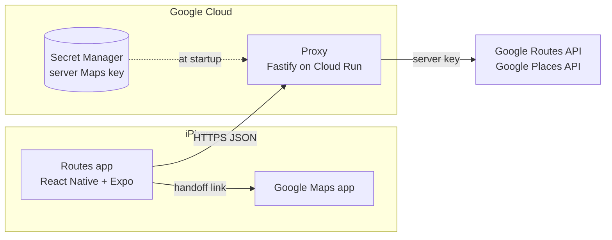
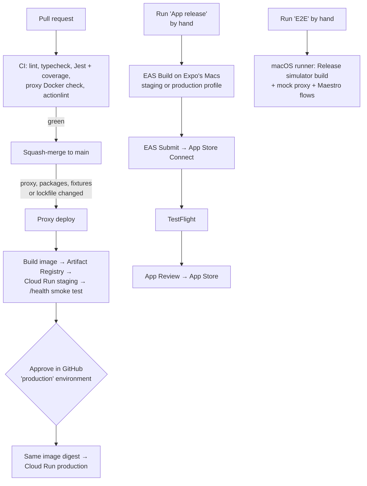

# Routes — Overview

**Start here.** This guide explains how the whole project fits together: the app's design, the tech stack, the code layout, how the app is built and shipped, and what runs on Expo, Google Cloud, Apple and GitHub. It links to the detailed docs instead of repeating them.

Routes is an iPhone app that shows drivers up to three routes to a destination, ranked **Fastest** or **Cheapest** (tolls plus estimated fuel), then hands the chosen route to Google Maps for navigation.

**Contents**

1. [The system at a glance](#1-the-system-at-a-glance)
2. [Tech stack](#2-tech-stack)
3. [React Native, Metro, Expo and the iOS shell](#3-react-native-metro-expo-and-the-ios-shell)
4. [Code structure and file layout](#4-code-structure-and-file-layout)
5. [Environments, keys and configuration](#5-environments-keys-and-configuration)
6. [Three ways to build: local, GitHub, Expo](#6-three-ways-to-build-local-github-expo)
7. [CI/CD flow](#7-cicd-flow)
8. [Platforms and their commands](#8-platforms-and-their-commands)
9. [Code signing](#9-code-signing)
10. [Lessons learned](#10-lessons-learned)
11. [Doc map](#11-doc-map)

## 1. The system at a glance



There are three parts:

- **The app (`apps/mobile`)** does everything the user sees:
  - search with autocomplete, and Home and Work;
  - ranking routes by time or cost, using the user's vehicle (mpg and fuel price), which never leaves the phone;
  - the map, the route cards and route detail;
  - handing off to Google Maps.
- **The proxy (`apps/proxy`)** is a small stateless web service on Cloud Run. It:
  - holds the Google **server** key, so the key is never in the app;
  - validates requests, rate-limits per device and caches responses;
  - calls Google, two Routes calls per search (with and without tolls) plus Places;
  - returns clean, typed JSON.

  It never ranks or prices routes.
- **Shared packages (`packages/`)** hold logic and types that both sides use:
  - `routing-core`: pure TypeScript for decoding, de-duplicating, costing, ranking and formatting routes;
  - `api-types`: the request and response schemas.

**Mock mode:** with `PROVIDER=mock`, the proxy serves recorded responses from `fixtures/` (around Denver) instead of calling Google. The whole app then runs with no keys and no accounts. Tests, CI and E2E all use mock mode.

Why it's built this way: [technical design](technical-design.md). What it must do: [business requirements](brd.md) and the [UX spec](ux-sketch.md).

## 2. Tech stack

### App (`apps/mobile`)

| Area | Technology | Used for |
|---|---|---|
| Language | TypeScript (strict) | All code |
| UI framework | **React 19** + **React Native 0.86** | Components rendered as real iOS views |
| JavaScript engine | **Hermes** (built into React Native) | Runs the app's JavaScript on the phone |
| Platform SDK | **Expo SDK 57** | Native modules, build tooling and config (see §3) |
| Navigation | **Expo Router** (`expo-router`), with `react-native-screens` | File-based routes: each file in `app/` is a screen |
| Server data | **TanStack Query** (`@tanstack/react-query`) | Fetching, caching and retrying proxy calls |
| App state | **Zustand** | Trip (start, destination, mode) and vehicle stores |
| Validation | **zod** (schemas from `@routes/api-types`) | Checks every proxy response |
| Storage | `expo-sqlite` | Recents, Home and Work, vehicle, preferences (migrations in `storage/`) |
| Location | `expo-location` | Current position (foreground only), reverse geocoding |
| Maps | `react-native-maps` | Apple Maps in development, Google Maps tiles in store builds |
| Network status | `@react-native-community/netinfo` | Offline detection, refetch on reconnect |
| Other Expo modules | `expo-linking` (open Google Maps), `expo-crypto` (device ID), `expo-constants` (config), `expo-splash-screen`, `expo-status-bar`, `expo-build-properties` (iOS 16.4 minimum) | — |
| UI support | `react-native-safe-area-context`, `react-native-svg`, `react-native-reanimated` + `react-native-worklets` | Layout, icons and illustrations, animations |

### Proxy (`apps/proxy`)

| Area | Technology |
|---|---|
| Runtime | Node 22, TypeScript |
| HTTP server | **Fastify 5** |
| Logging | **pino** (allow-listed fields only; never coordinates or search text) |
| Validation | zod (shared schemas) |
| Dev runner | `tsx watch` (`npm run proxy:dev` and `proxy:live`) |
| Container | Multi-stage `Dockerfile` → distroless Node 22 image, runs as `nonroot` |
| Hosting | Google Cloud Run (scales to zero) |

### Tooling and tests

| Tool | Used for |
|---|---|
| **npm workspaces** | One repo, one lockfile, four packages (`apps/*`, `packages/*`) |
| **Jest 30** (`ts-jest`, `jest-expo`) + React Native Testing Library | Unit, integration and screen tests: 5 projects, coverage gates |
| `nock` | Stubs Google in proxy tests (no real network in tests) |
| **Maestro** | End-to-end flows on the iOS simulator (`apps/mobile/e2e/`) |
| ESLint + Prettier | Lint and formatting (`npm run lint`, `npm run format`) |
| GitHub Actions | CI, E2E, proxy deploy, app release |
| **EAS** (Expo Application Services) | Cloud iOS builds and App Store submission |

## 3. React Native, Metro, Expo and the iOS shell

How TypeScript in this repo becomes an app on a phone.

```
 YOUR CODE                          GENERATED / INSTALLED               ON THE DEVICE
 apps/mobile (React, TypeScript)
 packages/* (routing-core, ...)  ──Metro──▶  JavaScript bundle ──────┐
                                                                      ▼
 apps/mobile/app.config.ts ──prebuild──▶ apps/mobile/ios/             Routes.app
                                         ├─ Routes (native shell) ──▶ native code
                                         └─ Pods (React Native,        + Hermes
                                                  Expo modules)        runs the bundle
                                    Xcode compiles ──────────────────┘
```

### The four pieces

| Piece | What it is | In this project |
|---|---|---|
| **React Native** | A framework for writing iOS (and Android) apps in React. Components like `<View>` and `<Text>` become real native views. JavaScript runs in the Hermes engine and calls native code through native modules. | Every screen in `apps/mobile/features/` |
| **Metro** | React Native's JavaScript bundler, like webpack for mobile. It compiles all the TypeScript (the app plus `packages/*`) into one bundle and serves it over HTTP on port **8081**. | `apps/mobile/metro.config.js` (Expo's monorepo-aware default) |
| **Expo** | A platform on top of React Native: a curated SDK of native modules (location, SQLite, linking…), the `expo` CLI, Expo Router, **config plugins**, and the EAS cloud services. | Expo SDK 57; the app's native setup is declared in `app.config.ts` |
| **The iOS shell** | The native Xcode project that hosts React Native: `AppDelegate`, `Info.plist`, icons, splash, and CocoaPods for React Native and the Expo modules. | `apps/mobile/ios/`, **generated** and git-ignored |

### Prebuild: the native project is generated, not written

Expo's **Continuous Native Generation**: `npx expo prebuild` (run automatically by `npm run ios` and by EAS) turns `apps/mobile/app.config.ts` into `apps/mobile/ios/`. That includes:

- the bundle ID, team, version, permission texts and query schemes;
- the splash screen and icon;
- config plugins, such as `react-native-maps` adding the Google Maps SDK.

Nothing in `ios/` is hand-edited, so deleting it is always safe. **Change `app.config.ts` or `.env`, delete `apps/mobile/ios`, and rebuild.** Expo Go (the generic sandbox app) can't run Routes, because Routes needs its own native configuration.

### Debug vs Release builds

| | Debug (development build) | Release (TestFlight, App Store, E2E) |
|---|---|---|
| Made by | `npm run ios -w @routes/mobile` (`expo run:ios`) | EAS Build, `--configuration Release`, or the E2E workflow |
| JavaScript | **Downloaded from Metro on your Mac** at each launch; edits reload in about a second (Fast Refresh) | **Embedded** in the app; no Mac needed |
| Works without the Mac? | No: on cellular, or with Metro stopped, it can't load | Yes |
| Dev menu (shake) and red error screen | Yes | No; errors close the app |

### The two servers on your Mac

| Port | Server | Started by | Serves |
|---|---|---|---|
| **8080** | The proxy | `npm run proxy:dev` (fixtures) or `npm run proxy:live` (Google, key from `.env`) | The app's **data** |
| **8081** | Metro | The last step of `npm run ios -w @routes/mobile`, or `npm run start -w @routes/mobile` | The app's **code** |

`npm run ios` runs prebuild if needed, then `pod install`, the Xcode build, install and launch, **then starts Metro in the same terminal**. Closing that terminal disconnects a Debug app from its code.

- **Simulator:** shares the Mac's network, so `localhost` works.
- **Phone:** `localhost` is the phone itself. A Debug build records the Mac's address to find Metro, and the proxy address comes from `EXPO_PUBLIC_PROXY_URL`: your Mac's Wi-Fi IP, or a Cloud Run URL. Both devices must be on the same Wi-Fi to reach your Mac.

### The QR code

`npm run start -w @routes/mobile` prints a QR code that opens a `routes://` link, the app's own URL scheme.

- **Before Routes is installed,** scanning does nothing.
- **Once it's installed,** scanning just opens the app.
- **Choosing a Metro server from the QR code** would need `expo-dev-client`, which the project doesn't use.

## 4. Code structure and file layout

```
Routes/
├─ apps/
│  ├─ mobile/                 Expo app (@routes/mobile)
│  │  ├─ app/                 Expo Router routes: thin files that render a screen
│  │  ├─ features/            Screens: home, search, results, detail, vehicle, onboarding, common UI
│  │  ├─ state/               Zustand stores, useRankedRoutes (calls routing-core)
│  │  ├─ api/                 Proxy client, TanStack Query hooks, error mapping, Places sessions
│  │  ├─ storage/             SQLite adapter, append-only migrations, repositories
│  │  ├─ location/            Permission and current-location tracking
│  │  ├─ handoff/             Google Maps link, open or not-installed handling, share text
│  │  ├─ i18n/  theme/  config/   Strings (all copy), light and dark tokens, runtime config
│  │  ├─ assets/              Icon and splash (SVG sources and rendered PNGs)
│  │  ├─ e2e/                 Maestro flows
│  │  ├─ test/                Jest tests, app harness, native-module mocks
│  │  ├─ app.config.ts        Expo config: bundle ID, plugins, permissions, env → app
│  │  ├─ eas.json             EAS build and submit profiles (staging, production)
│  │  └─ ios/                 GENERATED by prebuild (git-ignored)
│  └─ proxy/                  Fastify service (@routes/proxy) + Dockerfile
├─ packages/
│  ├─ routing-core/           Pure logic: polyline, overlap, cost, rank, format
│  └─ api-types/              zod schemas and types for the proxy contract
├─ fixtures/                  Google-format responses for mock mode (generated)
├─ scripts/                   Fixture generator
├─ tools/icons/               Renders the icon and splash PNGs from SVG (npm run icons)
├─ .github/workflows/         ci.yml, e2e.yml, proxy-deploy.yml, app-release.yml
├─ .github/actions/           cloud-run-deploy (shared deploy and smoke-test step)
├─ docs/                      This guide and the detailed docs
├─ AGENTS.md / CLAUDE.md      Rules for the coding agent
└─ .claude/settings.json      Claude Code permission allowlist
```

**Dependency rules:**

- The apps import the packages; nothing imports from `apps/`.
- `routing-core` stays pure: no React Native, Node, Expo or I/O.
- In the app, screens never call `fetch`, SQLite or Expo modules directly. They go through `state/`, `api/`, `storage/` and `location/`.
- Tests and Metro read the packages from source, so there's no build step during development.

Module by module, the provider tree and the data flow for a trip are in **[architecture.md](architecture.md)**. How to make common changes is in **[developer.md](developer.md#common-changes)**.

## 5. Environments, keys and configuration

### The three stages

Each tool has its own name for the same three stages:

| Stage | What it is | Google Cloud project | Proxy | Expo (EAS) environment | `eas.json` profile | Bundle ID |
|---|---|---|---|---|---|---|
| **Local dev** | Builds from your Mac (`npm run ios`) | `routes-nonprod` | Your Mac (`proxy:dev` / `proxy:live`) or staging | not used | not used | `com.rebound.routes.dev` on a phone (`com.routes.app.dev` default on the simulator) |
| **Staging** | TestFlight builds for everyday use | `routes-nonprod` | `https://routes-proxy-43ten57gha-uc.a.run.app` | `preview` | `staging` | `com.rebound.routes` |
| **Production** | The App Store build | `routes-prod` | `https://routes-proxy-mpq2ul73ra-uc.a.run.app` | `production` | `production` | `com.rebound.routes` |

Google Cloud **project IDs** (what commands need) differ from the display names: `routes-nonprod` is `routes-dev-512619`, and `routes-prod` is `routes-prod-512619`.

### Google Maps keys

| Key | Restricted to | Lives in | Used by |
|---|---|---|---|
| **Server key**, nonprod | Routes API, Places API (New) | Secret Manager `google-maps-api-key` in `routes-nonprod`; also the repo-root `.env` for `proxy:live` | Proxy (local and staging) |
| **Server key**, prod | Routes API, Places API (New) | Secret Manager `google-maps-api-key` in `routes-prod` only | Production proxy |
| **iOS key**, nonprod | Maps SDK for iOS; bundle IDs `com.rebound.routes.dev` and `com.rebound.routes` | `apps/mobile/.env` (`GOOGLE_MAPS_IOS_KEY`) and EAS `preview` | Map tiles in local and staging builds |
| **iOS key**, prod | Maps SDK for iOS; `com.rebound.routes` | EAS `production` (sensitive) | Map tiles in the store build |

Server keys never go in the app: anything in an app can be extracted. iOS keys are safe to ship because Google only accepts them from the listed bundle IDs. No key is ever committed. `.env` files are git-ignored.

### Where configuration comes from

| Setting | Local builds | EAS builds |
|---|---|---|
| Proxy URL, app env, map provider (`EXPO_PUBLIC_*`) | `apps/mobile/.env` | `env` in `eas.json` |
| `IOS_BUNDLE_IDENTIFIER`, `APPLE_TEAM_ID` | `apps/mobile/.env` | `env` in `eas.json` |
| `GOOGLE_MAPS_IOS_KEY` | `apps/mobile/.env` | EAS environment variables (expo.dev) |

`app.config.ts` reads these when the app is **built**, so changing them means rebuilding. The full variable list is in [apps/mobile/README.md](../apps/mobile/README.md#configuration) and [developer.md](developer.md#configuration).

## 6. Three ways to build: local, GitHub, Expo

| | **Local (your Mac)** | **GitHub Actions** | **Expo (EAS Build)** |
|---|---|---|---|
| What it produces | A Debug app on the simulator or your phone (or a Release one with `--configuration Release`) | Test results, a Docker image deployed to Cloud Run, a simulator Release build for E2E | A signed store build (`.ipa`), sent to TestFlight |
| How you start it | `npm run ios -w @routes/mobile` (add `-- --device` for the phone) | Automatically on PRs and merges, or by hand from the Actions tab | `npx eas-cli@latest build …`, or the **App release** workflow |
| Signing | Your Apple Development certificate (Xcode, automatic) | None needed (simulator and container) | Apple Distribution certificate and profile, stored on EAS |
| Runs the app's JavaScript from | Metro on your Mac (Debug) | Embedded (E2E Release build) | Embedded |
| Cost | Free | Free for Linux jobs; the macOS E2E job is slow (about an hour) | Counts against the EAS plan's monthly builds; `--local` builds on your Mac for free |
| Use it for | Day-to-day development and on-device testing | The merge gate, deploying the proxy, E2E before releases | TestFlight and App Store builds |

## 7. CI/CD flow



| Workflow | Trigger | What it does | Doc |
|---|---|---|---|
| `ci.yml` | Every PR and push to `main` | The merge gate (about 2 minutes) | [developer.md → CI](developer.md#ci) |
| `e2e.yml` | Manual only | Maestro flows on a macOS runner (about an hour); not a merge gate | [INTEG.md](INTEG.md) |
| `proxy-deploy.yml` | Merges touching the proxy or its inputs, or manual | Staging automatically; production after your approval | [deploy.md](deploy.md) |
| `app-release.yml` | Manual only (profile, submit on or off) | Queues an EAS build and optional TestFlight submit; production needs approval | [release.md](release.md) |

**Approvals:** when a production deploy or release is waiting, GitHub emails you. Approve under **Actions** → the run → **Review deployments** → **Approve and deploy**. Ignoring a request is safe: production keeps the previous version.

**Work tracking:** GitHub issues, with the pinned tracker [#38](https://github.com/trietlu/Routes/issues/38). `R-xx` issues are code (originally for the coding agent, see [AGENT-LOOP.md](AGENT-LOOP.md)), and `H-xx` (`needs-human`) issues are account and launch tasks. The order is in [PLAN.md](PLAN.md).

## 8. Platforms and their commands

### Expo / EAS

| What | Value |
|---|---|
| Account and project | `triet05`, project `@triet05/routes` (ID in `app.config.ts`) |
| Build profiles | `staging` and `production` in `apps/mobile/eas.json`; build numbers managed by EAS (`autoIncrement`) |
| Stored on EAS | Apple Distribution certificate and provisioning profile (valid to Nov 2027), App Store Connect API key, `GOOGLE_MAPS_IOS_KEY` (`preview`, `production`) |
| Submits to | App Store Connect app ID `6832004102` (`ascAppId`) |
| Not used | Expo Go, `expo-dev-client`, OTA updates (`expo-updates`) |

Run these from `apps/mobile`:

| Task | Command |
|---|---|
| Log in | `npx eas-cli@latest login` |
| Build for TestFlight and submit when done | `npx eas-cli@latest build --profile staging --platform ios --auto-submit` |
| Build only / submit the latest build | `npx eas-cli@latest build --profile staging --platform ios` / `npx eas-cli@latest submit --profile staging --platform ios --latest` |
| Build on your Mac (free) and upload | `npx eas-cli@latest build --profile staging --platform ios --local`, then `npx eas-cli@latest submit --path <file>.ipa` |
| List builds | `npx eas-cli@latest build:list --platform ios` |
| Signing and API keys | `npx eas-cli@latest credentials` |
| Environment variables | `npx eas-cli@latest env:list --environment preview` |

Details: [release.md](release.md).

### Google Cloud

| What | Value |
|---|---|
| Projects | `routes-nonprod` (`routes-dev-512619`), `routes-prod` (`routes-prod-512619`) |
| APIs | Routes API, Places API (New), Maps SDK for iOS; Cloud Run, Artifact Registry, Secret Manager, IAM Credentials, STS |
| Cloud Run | Service `routes-proxy` in `us-central1` in each project; 0 to 20 instances, 1 vCPU, 512 MiB |
| Images | Artifact Registry `routes` (nonprod) holds both environments' images; keeps the newest 5 and deletes images older than 30 days |
| Accounts | `proxy-deployer@routes-dev-512619` (used by GitHub through Workload Identity Federation, no JSON keys); `proxy-runtime@<project>` in each project (reads the Maps secret) |
| Cost guards | $50 budget alerts per project; per-API daily and per-minute quota caps; min instances 0; no load balancer or Cloud Armor |

| Task | Command |
|---|---|
| Log in, list projects | `gcloud auth login` · `gcloud projects list` |
| Service URL | `gcloud run services describe routes-proxy --project routes-prod-512619 --region us-central1 --format "value(status.url)"` |
| Recent proxy logs | `gcloud logging read "resource.type=cloud_run_revision AND resource.labels.service_name=routes-proxy" --project routes-dev-512619 --limit 30 --freshness 30m` |
| Health check | `curl https://routes-proxy-43ten57gha-uc.a.run.app/health` (not `/healthz`, see §10) |
| Every setup command (APIs, registry, accounts, WIF, secrets) | [deploy.md → Google Cloud](deploy.md#google-cloud) |

### Apple

| What | Value |
|---|---|
| Developer Program | Individual, team ID `5T7CA68Q3C` |
| App ID | `com.rebound.routes` (store); `com.rebound.routes.dev` registered automatically by Xcode for local device builds |
| App Store Connect | "Routes: Get there fast & cheap", Apple ID `6832004102`; testing through TestFlight → Internal Testing |
| Certificates | Apple Development (your Mac, managed by Xcode) for local device builds; Apple Distribution (managed by EAS) for store builds |

Where things are:

- **developer.apple.com → Certificates, Identifiers & Profiles:** App IDs, capabilities, certificates, devices.
- **appstoreconnect.apple.com:** the app record, TestFlight, listing, privacy and review.
- **Xcode → Settings → Apple Accounts:** your teams and certificates on this Mac.

Phone setup, signing errors and `xcrun` diagnostics are in [DEVICE-TESTING.md](DEVICE-TESTING.md).

### GitHub

| What | Value |
|---|---|
| Repository variables | `GCP_WORKLOAD_IDENTITY_PROVIDER`, `GCP_SERVICE_ACCOUNT`, `GCP_PROJECT_STAGING`, `GCP_PROJECT_PRODUCTION`, `CLOUD_RUN_MIN_INSTANCES_PRODUCTION=0`, `ATTEST_MODE_PRODUCTION=off` |
| Secrets | `EXPO_TOKEN` (EAS access token) |
| Environments | `staging` (no protection), `production` (you as required reviewer) |

| Task | Command |
|---|---|
| PR checks | `gh pr checks <number> --repo trietlu/Routes` |
| Start a workflow | `gh workflow run app-release.yml --repo trietlu/Routes -f profile=staging -f submit=true` · `gh workflow run E2E --repo trietlu/Routes --ref main` |
| Watch runs | `gh run list --repo trietlu/Routes --limit 5` · `gh run watch <run-id> --repo trietlu/Routes` |
| Set a variable or secret | `gh variable set <NAME> --repo trietlu/Routes --body <value>` · `gh secret set <NAME> --repo trietlu/Routes` (prompts for the value) |
| Issues waiting on you | `gh issue list --repo trietlu/Routes --label needs-human` |

Everyday local commands (proxy, simulator, tests, disk cleanup) are in [COMMANDS.md](COMMANDS.md).

## 9. Code signing

An iPhone only runs **signed** apps. The simulator doesn't need signing.

| Piece | What it is | Local device builds | Store builds |
|---|---|---|---|
| **Team** | The developer identity | `5T7CA68Q3C`, set with `APPLE_TEAM_ID` in `.env`, so prebuild doesn't pick the free "(Personal Team)" Xcode also creates | Same |
| **Certificate** | Signing key in the keychain | Apple Development (Xcode creates it) | Apple Distribution (EAS creates and stores it) |
| **App ID** | Bundle ID | `com.rebound.routes.dev` | `com.rebound.routes` |
| **Provisioning profile** | "This certificate may install this app on these devices, with these capabilities" | Development profile listing your iPhone (Xcode, automatic) | App Store profile (EAS) |

**Capabilities** (App Attest, push and so on) are switched on for the App ID and recorded in the profile. EAS syncs them to what the app uses on each build. App Attest is currently off because #27 isn't built yet.

In Xcode: `open apps/mobile/ios/Routes.xcworkspace` → blue **Routes** project → **Routes** target → **Signing & Capabilities**.

## 10. Lessons learned

Pitfalls hit while setting this up, kept here so they aren't repeated:

| Symptom | Cause and fix |
|---|---|
| The app doesn't load on cellular | It was a **Debug** build, which needs Metro on the Mac. Use TestFlight, or build with `--configuration Release`. |
| Cloud Run `/healthz` returns Google's 404 page | `run.app` reserves paths ending in `z`. Deployed checks use `/health`; `/healthz` still works locally. |
| Google map tiles missing in store builds | `ios.config.googleMapsApiKey` is ignored with react-native-maps 1.27. `app.config.ts` passes the key to the `react-native-maps` plugin (`iosGoogleMapsApiKey`), which also adds the Google Maps SDK. |
| `eas build` fails: "brace_expansion_1.expand is not a function" | A lockfile entry was missing for `@expo/fingerprint`'s dependencies. Fixed in #95. If it recurs, `npm ls brace-expansion` shows the invalid copy. |
| `eas submit` created a second App Store Connect app, and Apple rejected the build (ITMS-90055) | `eas submit` doesn't apply build-profile env, so it used the default bundle ID. `ascAppId` in `eas.json` now pins the real app. Delete stray app records under App Information → Remove App. |
| The Xcode team keeps resetting to "(Personal Team)" | Xcode creates a free Personal Team for every Apple ID. Set `APPLE_TEAM_ID` in `apps/mobile/.env`. |
| A `.env` or `app.config.ts` change has no effect | They're read at build time. Delete `apps/mobile/ios` and rebuild. |
| "Missing Compliance" on each TestFlight build | Fixed with `ITSAppUsesNonExemptEncryption: false` (the app uses only HTTPS). |
| Build fails with `cannot find type '__ObjC::expo'` on a new Xcode | Expo's precompiled modules must match Xcode's Swift. Update Expo patch versions, run `npm ci`, delete `apps/mobile/ios` and rebuild. See [developer.md → Troubleshooting](developer.md#troubleshooting). |

## 11. Doc map

| Doc | Read it when you want to… |
|---|---|
| [brd.md](brd.md) | Know **what** the app must do: requirements FR-1 to FR-22, non-functional requirements, business rules |
| [ux-sketch.md](ux-sketch.md) | See the screens, states and exact copy |
| [technical-design.md](technical-design.md) | Understand **why** it's built this way: proxy contract, ranking and overlap algorithms, privacy, hosting |
| [architecture.md](architecture.md) | Find your way around the code: modules, layers, provider tree, data flow, test seams |
| [developer.md](developer.md) | Set up, run, test and change the code; CI jobs; troubleshooting |
| [COMMANDS.md](COMMANDS.md) | Copy-paste everyday commands |
| [DEVICE-TESTING.md](DEVICE-TESTING.md) | Run on the simulator or your iPhone; signing errors; `xcrun` diagnostics |
| [test-plan.md](test-plan.md) | Look up test IDs, canonical fixture values and the definition of done |
| [INTEG.md](INTEG.md) | Run or change the Maestro E2E flows |
| [deploy.md](deploy.md) | Deploy the proxy to Cloud Run; the Google Cloud setup commands |
| [release.md](release.md) | Build with EAS, submit to TestFlight, release to the App Store |
| [PLAN.md](PLAN.md) | See the build order and milestones |
| [AGENT-LOOP.md](AGENT-LOOP.md) and [AGENTS.md](../AGENTS.md) | Run the autonomous coding agent and see its rules |
| [fixtures/README.md](../fixtures/README.md), [apps/mobile/assets/README.md](../apps/mobile/assets/README.md) | Mock data, and the icon and splash sources |
