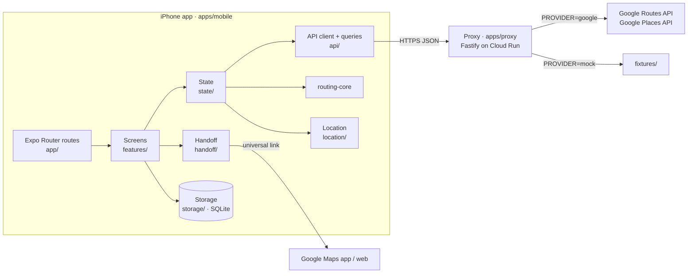
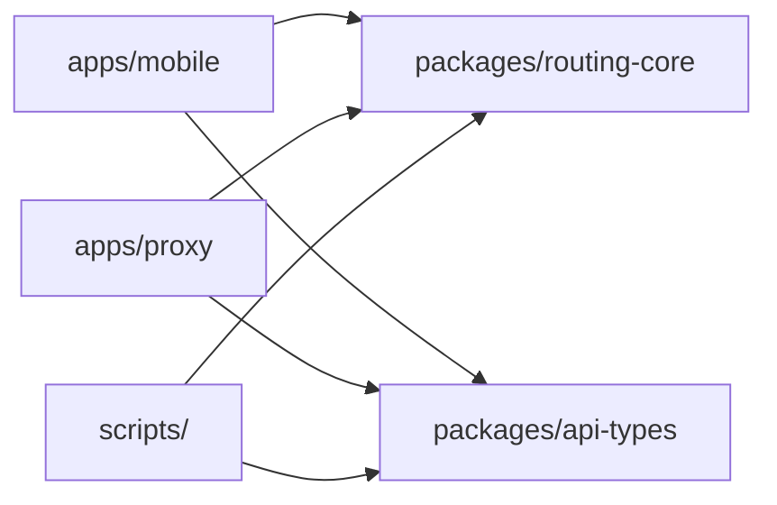
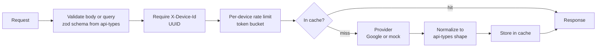

# Routes — Architecture (as built)

Related: [Technical design](technical-design.md) (the why and the contracts) · [Developer guide](developer.md) (how to work in the repo)

This document describes how the code is actually organized and wired. For the reasoning behind each choice, see the technical design. For exact API shapes, see `packages/api-types`. Where this document and the code disagree, the code wins; fix this document.

## System overview



- **The app is the only client.** It talks to the proxy for routes and places, and to Google Maps only through the handoff link.
- **The proxy is stateless.** It validates, rate-limits, caches in memory, calls Google (or fixtures), and normalizes responses. It never ranks or prices routes.
- **Ranking and cost run on the phone,** in `routing-core`, so the vehicle profile never leaves the device.

## Workspaces and dependency rules

npm workspaces. Arrows mean "imports".



| Workspace | Role | May import |
|---|---|---|
| `packages/routing-core` | Pure logic: polyline, geometry, overlap, cost, ranking, formatting, display strings | Nothing: no React Native, Node, Expo or I/O |
| `packages/api-types` | zod schemas and types for the proxy contract, header names, error codes | `zod` only |
| `apps/proxy` | HTTP service | `api-types`, `routing-core`, Fastify, pino, zod |
| `apps/mobile` | Expo app | `api-types`, `routing-core`, Expo and React Native libraries |
| `scripts/` | Fixture generator | `routing-core` (`encodePolyline`), `api-types` |

The dependency arrows only point one way: nothing imports from `apps/`, and the packages never depend on each other at runtime beyond what's shown.

Tests and Metro resolve the workspace packages **from source** (Jest `moduleNameMapper`, and Expo's monorepo-aware Metro config), so no build step is needed during development. The proxy's Docker image builds them with `tsc --build`.

## Proxy (`apps/proxy`)

### Request lifecycle

Every non-health request goes through the same steps in `app.ts`:



Errors anywhere become a `ProxyError`, which the error handler turns into the `{ error: { code, message } }` envelope with the right status code. One log line is written per request, with method, route, status, latency, `cacheHit` and error code. Bodies, query strings and coordinates are never logged.

### Modules

| File | Responsibility |
|---|---|
| `server.ts` | Process entry: loads config, builds the app, listens on `PORT`, handles SIGTERM. |
| `app.ts` | `buildApp(config, options)`: Fastify instance, routes, validation, device ID, rate limiting, caching, error handler. Tests call this in-process. |
| `config.ts` | Env vars validated by zod. `PROVIDER` defaults to `mock` outside production. Requires `GOOGLE_MAPS_API_KEY` when `PROVIDER=google`. |
| `providers.ts` | `RoutesProvider` and `PlacesProvider` interfaces; `createProviders(config)` chooses Google or mock. |
| `routes/google.ts` | Two parallel `computeRoutes` calls (tolls, and avoid tolls) with the field mask and `TOLLS` computation. |
| `routes/normalize.ts` | Google route to `ProviderRoute`: duration parsing, USD toll sum, flattened steps. |
| `routes/merge.ts` | Combines both calls:<br/>• One call failing or returning malformed data is ignored if the other returns routes.<br/>• Both calls failing gives `UPSTREAM_TIMEOUT` when every failure was a timeout, else `UPSTREAM_ERROR`.<br/>• Both succeeding with no routes gives `NO_ROUTE`.<br/>• One failing while the other finds nothing reports the failure, since the failed call might have had routes. |
| `routes/mock.ts`, `places/mock.ts` | Read `fixtures/` per `fixtures/index.json` and run the **same** normalization as Google. |
| `places/google.ts`, `places/normalize.ts` | Places API (New) autocomplete and details. |
| `upstream.ts` | `fetch` with timeout; maps failures to `UPSTREAM_ERROR` or `UPSTREAM_TIMEOUT` and discards upstream error bodies. |
| `cache.ts` | TTL LRU cache and the cache-key builders (rounded coordinates). |
| `rateLimit.ts` | Rolling-hour token bucket per device ID. |
| `errors.ts` | `ProxyError` and the error envelope. |
| `logging.ts` | pino logger with an allow-list of logged fields. |

**Seams for tests:** `buildApp` accepts `providers` (fakes), `logStream` (to capture and inspect log lines) and `now` (a fake clock for TTLs and rate limits). Google calls take an injectable `fetch`, which tests stub with `nock`.

## routing-core (`packages/routing-core`)

| Module | Exports |
|---|---|
| `polyline.ts` | `decodePolyline`, `encodePolyline` |
| `geometry.ts` | Haversine, point-to-segment distance, resampling, `pointAlongPolyline` (map bubble placement) |
| `overlap.ts` | `routeOverlap`, `OVERLAP_THRESHOLD` and related constants |
| `cost.ts` | `DEFAULT_VEHICLE`, `computeCost` |
| `rank.ts` | `rankRoutes(routes, mode, vehicle)`: cost → sort → dedupe → top 3 → letters → diffs |
| `format/` | Duration, distance, money, toll status, card cost, diff strings, card accessibility label, `selectKeySteps`, and the English string table with `interpolate` |

Strings are produced through an injectable `Translate` function, so the app supplies its own i18n table (`coreT` in `apps/mobile/i18n`).

## Mobile app (`apps/mobile`)

### Layers

| Layer | Folder | Depends on |
|---|---|---|
| Routes | `app/` (Expo Router) | `features/` only. Each file is a thin wrapper that reads URL params and renders a screen. |
| Screens | `features/<screen>/` | state, api hooks, storage (through `useStorage`), handoff, theme, i18n |
| State | `state/` | api, storage repos, location, routing-core |
| Data access | `api/`, `storage/`, `location/`, `handoff/` | api-types, Expo modules |
| Foundation | `config/`, `theme/`, `i18n/` | none |

Screens never call `fetch`, SQLite or Expo modules directly. They go through the layer below.

### Provider tree

`app/_layout.tsx` wraps every screen in `AppProviders` (`features/app/services.tsx`):

```
SafeAreaProvider
└─ AppProviders: opens storage once, then:
   ├─ StorageContext            storage repos (useStorage)
   ├─ ApiProvider               API client, Places session, TanStack QueryClient (useApi)
   └─ StateProvider             trip store, vehicle store, location source
                                (useTrip, useVehicle, useCurrentLocationSource)
      └─ <Stack>                Expo Router screens
```

`AppProviders` renders nothing until storage has opened; the native splash screen covers that moment. `wireOnlineManager()` connects NetInfo to TanStack Query, so queries refetch on reconnect.

### State

| Store or hook | Holds | Persistence |
|---|---|---|
| `tripStore` (Zustand) | `start`, `destination` (a Place or `'current'`), `mode`, `selectedLetter`; actions `setStart`, `setDestination`, `swap`, `setMode`, `select` | `mode` saved to preferences (`lastMode`) |
| `vehicleStore` (Zustand) | Vehicle profile; `save()` | SQLite through `VehicleRepo` |
| TanStack Query | Routes, autocomplete, place details, current coordinates | Memory only |
| `useRankedRoutes()` | Derived: `{ status, options, onlyN, errorKind, start, destination, retry }` | none |

### Data flow for a trip

```mermaid
sequenceDiagram
  participant UI as ResultsScreen
  participant RR as useRankedRoutes
  participant Q as TanStack Query
  participant API as ApiClient
  participant PX as Proxy
  participant RC as routing-core
  UI->>RR: render
  RR->>Q: currentLocation (if an end is 'current')
  RR->>Q: useRoutes(start, destination)
  Q->>API: postRoutes (cache miss)
  API->>PX: POST /routes + X-Device-Id
  PX-->>API: { routes } (validated with api-types)
  API-->>Q: cached 2 min, key excludes mode
  RR->>RC: rankRoutes(routes, mode, vehicle)
  RC-->>UI: up to 3 RouteOptions + onlyN
  Note over UI,RC: Changing mode or vehicle re-runs only rankRoutes; no new request
```

### Data access modules

| Folder | Key pieces |
|---|---|
| `api/` | `createApiClient` (typed fetch, 10 s timeout, schema-validated responses, `X-Device-Id`, attestation hook); `errors.ts` maps failures to `offline`, `noRoute`, `rateLimited` and `generic`; `hooks.ts` (`useAutocomplete` with a 300 ms debounce, `usePlaceDetails`, `useRoutes`); `session.ts` (Places session tokens); `network.ts` (NetInfo) |
| `storage/` | `SqlDatabase` adapter interface; `expoDatabase.ts` (expo-sqlite); `migrations.ts` (numbered, append-only); repos `places.ts` (recents capped at 10, Home/Work), `vehicle.ts`, `preferences.ts` (`lastMode`, prompt flags, `deviceId`) |
| `location/` | `permissions.ts` (foreground only, never requested automatically); `currentLocation.ts` (`useCurrentLocation` with a 5 s timeout and reverse geocoding; `deviceLocationSource`) |
| `handoff/` | `link.ts` (`buildDirectionsUrl`, `APP_STORE_URL`); `open.ts` (`openInGoogleMaps` through an injectable `Linker`); `share.ts` (`buildShareText`) |

### Screens

| Route | Screen component |
|---|---|
| `onboarding` | `features/onboarding/OnboardingScreen` |
| `index` (Home) | `features/home/HomeScreen`, with `HomeMap`, `TripCard`, `ModeToggle`, `PlaceRow` |
| `search` | `features/search/SearchScreen` |
| `set-place/[kind]` | `SearchScreen` in Set Home or Set Work mode |
| `results` | `features/results/ResultsScreen`, with `ResultsMap`, `RouteCard`, `VehiclePrompt` |
| `route/[letter]` | `features/detail/RouteDetailScreen`, with `NotInstalledSheet` |
| `vehicle` | `features/vehicle/VehicleScreen`, with field rules in `validation.ts` |

`features/common/` holds shared UI: `AppText` (Dynamic Type), `Button` (44 pt minimum), icons, and `useNow` (a clock for arrival times).

### Configuration, theme and strings

- **Config:** `app.config.ts` reads `EXPO_PUBLIC_*` variables at build time into `extra`; `config/env.ts` (`getAppConfig()`) reads them at runtime.
- **Theme:** `theme/tokens.ts` holds the light and dark tokens, including route colors A/B/C; `useTheme()` picks the scheme. `theme/contrast.ts` lets tests check the 4.5:1 contrast ratio.
- **Strings:** all copy lives in `i18n/strings.ts`, read through `t()`. A test fails on raw text in JSX under `features/`.

### Seams for tests

| Seam | Replaced by |
|---|---|
| `configureStorageOpener()` | In-memory SQLite (`test/nodeSqlite.ts`, Node's built-in SQLite behind `SqlDatabase`) |
| `configureApiClient()` | Fake client returning fixture data (`test/flows.tsx`, `fakeRoutesClient`) |
| `CurrentLocationSource` | Fake coordinates |
| `Linker` | Fake `canOpenURL` and `openURL` |
| Native modules | `test/mocks/` (maps, location, SQLite, linking, NetInfo, crypto) |

`test/appHarness.tsx` renders the **real** app, with every route and the root layout, through `expo-router/testing-library`. `test/flows.tsx` has helpers that drive it to Results or Detail in one call.

## Fixtures and mock mode

`fixtures/` holds raw Google-format responses, generated deterministically by `scripts/generate-fixtures.ts` around a fixed origin (Denver, 39.7392, -104.9903). The mock providers serve them through the same normalization as live Google, so mock mode exercises nearly the whole proxy. See [fixtures/README.md](../fixtures/README.md).

## Delivery

| Piece | How it ships | Doc |
|---|---|---|
| CI | `.github/workflows/ci.yml`: lint, typecheck and Jest with coverage (ubuntu); proxy Docker build and `/healthz` check; actionlint | [developer.md](developer.md#ci) |
| Proxy | `.github/workflows/proxy-deploy.yml` to Cloud Run staging, then production (manual approval). Skips until GCP is configured. | [deploy.md](deploy.md) |
| App | EAS Build, Submit and Update (planned, R-28) | [technical-design.md](technical-design.md#hosting-and-deployment) |
| E2E | Maestro flows in `apps/mobile/e2e/` on a `macos-26` runner (`.github/workflows/e2e.yml`), run manually; not a merge gate | [test-plan.md](test-plan.md#8-end-to-end-tests--maestro-e2e-) |

## Invariants to preserve

- `routing-core` stays pure: no I/O and no platform imports.
- Mode and vehicle changes never trigger a network request; the routes query key excludes them.
- The proxy normalizes; the app ranks. Raw Google payloads never reach the app.
- No coordinates, addresses or search text in logs, on the proxy or in the app.
- Mock mode keeps working with no keys: `npm run proxy:dev` plus the simulator runs the whole app.
- Migrations are append-only.
- All copy goes through `i18n/`.
